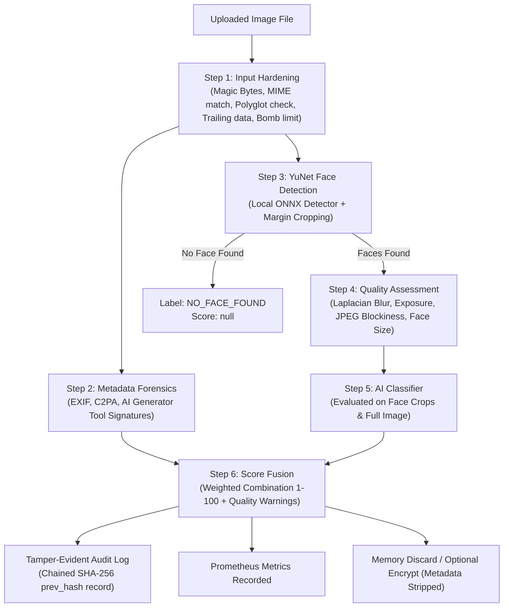

# FaceCheck API: Bank Offline Face AI-Verification Service

**FaceCheck API** is a hardened, **100% offline REST API** designed for banks to verify whether human faces in advertising images are authentic or synthetic/AI-generated (e.g., generated via Midjourney, Stable Diffusion, DALL-E, Firefly, or FaceSwap tools).

The service operates in an air-gapped environment with **zero internet access**, **zero CDN dependencies**, **no runtime downloads**, strict biometric data privacy controls, and a tamper-evident audit log.

---

## Key Features

- **Strict Offline Runtime**: All model weights, libraries, and Swagger documentation run locally.
- **Biometric Security & Ephemeral Processing**: Uploaded images are processed in volatile memory and discarded immediately by default (zero image footprint on disk). Optional AES-256-GCM encryption with EXIF/metadata stripping can be enabled.
- **Unified Risk Score (1–100)**:
  - `1–30`: **`LIKELY_REAL`** (natural facial biometrics, authentic camera metadata)
  - `31–70`: **`UNCERTAIN`** (requires compliance officer human review)
  - `71–100`: **`LIKELY_FAKE`** (strong synthetic artifacts, AI generation parameters)
  - Special label: **`NO_FACE_FOUND`** (score `null` if no human face is detected)
- **Pre-Flight Image Quality Check**: Evaluates blur (Laplacian variance), under/over-exposure, resolution, face crop size, and JPEG compression blockiness; returns a diagnostic `quality` object.
- **Input Hardening & Decompression Bomb Protection**: Pillow `MAX_IMAGE_PIXELS` limits, dimension constraints, polyglot signature rejection, trailing data rejection, and sandboxed worker execution with timeouts.
- **Tamper-Evident SHA-256 Audit Log**: Every check entry includes `prev_hash` chaining back to genesis. Verified with `scripts/verify_audit_log.py`.
- **Prometheus Observability**: Exposes real-time request counts, latencies, score distributions, and quality metrics at `GET /api/v1/metrics`.
- **Hardened Container Runtime**: Multi-stage Dockerfile, non-root user (`10001:facecheck`), read-only rootfs, `cap_drop: ALL`, `no-new-privileges`, and tmpfs mounts.
- **Model Tamper Proofing**: Verifies SHA-256 hashes against `models/CHECKSUMS.txt` at application startup.

---

## Tech Stack

- **Language & Server**: Python 3.11 / 3.13, FastAPI, Uvicorn
- **Face Detection**: OpenCV YuNet ONNX (`models/face_detection_yunet_2023mar.onnx`, Apache-2.0)
- **Deepfake / AI Detector**: HuggingFace Safetensors detector (`local_files_only=True`, `.safetensors` format, MIT/Apache) or ONNX Runtime
- **Metadata & Forensics**: Pillow, `exifread`, C2PA Content Credentials parser
- **Security & Cryptography**: AES-256-GCM, SHA-256 hash chains
- **Metrics**: Standard Prometheus text exposition (`/api/v1/metrics`)

---

## Project Structure

```
facecheck_api/
├── app/
│   ├── __init__.py
│   ├── main.py                     # FastAPI application, security headers, startup checksum verification
│   ├── config.py                   # Pydantic Settings & YAML loader (thresholds, quality, hardening)
│   ├── api/
│   │   ├── __init__.py
│   │   ├── dependencies.py         # API key validation (X-API-Key) & sliding-window rate limiter
│   │   └── routes.py               # POST /check, GET /health, GET /metrics
│   ├── services/
│   │   ├── __init__.py
│   │   ├── validator.py            # Step 1: Magic bytes, MIME, polyglot rejection, trailing data, size (413)
│   │   ├── metadata.py             # Step 2: EXIF & C2PA extraction, AI tool signatures
│   │   ├── face_detector.py        # Step 3: YuNet ONNX face detection, margin cropping, NO_FACE_FOUND
│   │   ├── quality.py              # Step 4: Quality checks (Laplacian blur, luminance, compression, face size)
│   │   ├── pipeline.py             # Unified pipeline runner (used by API and evaluation harness)
│   │   ├── sandbox.py              # Process-sandboxed worker execution with timeout & crash isolation
│   │   ├── fusion.py               # Step 5: Weighted fusion 1-100, label mapping, reasons list
│   │   ├── audit.py                # SHA-256 hash-chained tamper-evident audit log & optional syslog
│   │   ├── encryption.py           # Optional AES-GCM encryption with metadata stripping
│   │   └── metrics.py              # Thread-safe Prometheus metrics collector
│   ├── detectors/
│   │   ├── __init__.py
│   │   ├── base.py                 # Abstract BaseDetector interface (predict(image) -> float 0-1)
│   │   ├── hf_detector.py          # HuggingFace Safetensors detector (local_files_only=True)
│   │   ├── onnx_detector.py        # ONNX Runtime detector for ONNX model weights
│   │   ├── safetensors_detector.py # Pure-Python zero-dependency .safetensors neural classifier
│   │   ├── mock_detector.py        # Mock/test detector with deterministic scoring
│   │   └── factory.py              # Detector factory with graceful dev/test fallback
│   └── static/swagger/             # Offline Swagger UI bundle (zero external CDN calls)
├── eval/
│   ├── data/
│   │   ├── real/                   # Place real advertisement face images here
│   │   └── fake/                   # Place AI-generated face images here
│   └── reports/                    # Standalone JSON, HTML evaluation reports, and SBOM
├── logs/
│   └── audit.log                   # Cryptographically chained audit log
├── models/
│   ├── CHECKSUMS.txt               # SHA-256 hashes for all model weight files
│   ├── face_detection_yunet_2023mar.onnx
│   └── deepfake_detector/          # Trained safetensors weights and configuration
├── scripts/
│   ├── evaluate.py                 # Full evaluation harness (Accuracy, ROC-AUC, FPR, FNR, HTML report)
│   ├── verify_audit_log.py         # SHA-256 audit log integrity verifier
│   ├── scan_image.sh               # Offline container vulnerability scanner (Trivy)
│   ├── make_sbom.py                # CycloneDX 1.5 SBOM generator
│   ├── make_sbom.sh                # Bash SBOM generator wrapper
│   ├── train_classifier.py         # Offline classifier training utility
│   └── verify_checksums.py         # Startup model checksum verifier
├── tests/                          # Comprehensive pytest test suite (57 tests)
├── config.yaml                     # Application settings (security, thresholds, quality, hardening)
├── requirements.txt                # Pinned Python dependencies
├── Dockerfile                      # Hardened multi-stage non-root containerfile
├── docker-compose.yml              # Local container stack with resource limits (direct port 8000)
├── THIRD_PARTY_LICENSES.md         # Open-source license inventory for bank compliance
└── LIMITATIONS.md                  # Comprehensive AI detection limitations for bank risk officers
```

---

## 5-Step Hardened Analysis Pipeline



---

## How to Prepare the Test Set (Evaluation)

The evaluation harness measures real-world accuracy, false positive rate (real marked fake), false negative rate (fake marked real), ROC-AUC, and generates a standalone visual report.

### 1. Data Collection Recommendations
For rigorous bank validation:
- **Sample Size**: Collect **500 to 1,000 labeled test images** (e.g., 500 Real, 500 Fake).
- **Strict Separation**: **NEVER** use images that were included in model training.
- **Real Images (`eval/data/real/`)**:
  - Genuine digital advertisement banners and spokesperson portraits.
  - Authentic smartphone and DSLR photography under varied studio and outdoor lighting.
  - Diverse demographics, skin tones, age groups, and cultural attire.
- **Fake Images (`eval/data/fake/`)**:
  - Sample across multiple modern AI generator architectures:
    - Diffusion models: Midjourney (v5, v6), Stable Diffusion (SD 1.5, SDXL, Flux.1), DALL-E 3.
    - Face-swapping algorithms: Roop, InsightFace-swaps, SimSwap.
    - Commercial creative tools: Adobe Firefly, Canva AI, Bing Image Creator.
  - Varied export resolutions and compression levels typical of ad uploads.

### 2. Running the Evaluation Harness
Execute the evaluation script:
```bash
python scripts/evaluate.py
```
Or specify custom paths and decision threshold:
```bash
python scripts/evaluate.py --real-dir eval/data/real --fake-dir eval/data/fake --threshold 50
```

### 3. Output Reports & Quality Gates
- **Console Output**: Displays summary metrics and evaluates against `config.yaml` `eval.min_acceptable` thresholds (`max_false_positive_rate: 0.05`, `max_false_negative_rate: 0.05`, `min_accuracy: 0.90`).
- **Prints `[PASS]` or `[FAIL]`**: Directly enforces bank quality gate criteria.
- **JSON Report**: Saved to `eval/reports/eval_report_<timestamp>.json` and `eval/reports/latest.json`.
- **Visual HTML Report**: Saved to `eval/reports/eval_report_<timestamp>.html` and `eval/reports/latest.html`.
  - Self-contained with **zero external CSS/JS** (air-gapped browser compatible).
  - Displays confusion matrix, threshold comparison sweep (20 to 80), and an itemized table of misclassified images.

---

## Image Quality Assessment (`quality` Object)

Every `/api/v1/check` response includes a `quality` object:

```json
"quality": {
  "status": "LOW_QUALITY",
  "issues": [
    "Image appears blurry (Laplacian variance: 34.2, threshold: 50.0)",
    "Image is underexposed / very dark (mean luminance: 18.4/255, threshold: 25.0)"
  ],
  "metrics": {
    "width": 800,
    "height": 600,
    "laplacian_variance": 34.2,
    "mean_luminance": 18.4,
    "compression_ratio": 0.021,
    "blockiness_index": 1.25,
    "face_count": 1,
    "small_faces_count": 0
  }
}
```

If `status == "LOW_QUALITY"`, the API still computes the risk score, but appends a cautionary warning to `reasons` explaining that low image quality reduces score reliability.

---

## Input Hardening & Sandboxing

The service is hardened against adversarial file attacks:
- **Decompression Bombs**: Protected via `Image.MAX_IMAGE_PIXELS` (default: 25,000,000) and max dimension limits ($8,192 \times 8,192$). Oversized images are rejected immediately with **HTTP 413**.
- **Polyglot & Malicious Code Rejection**: Inspects byte streams for hidden file headers (`%PDF`, `PK\x03\x04`, `MZ`, `\x7fELF`, `<script>`, `<?php`, `<svg`). Polyglots are rejected with **HTTP 400**.
- **Trailing Data Rejection**: Validates file termination against EOF markers (JPEG `FF D9`, PNG `IEND`, WebP RIFF sizes). Extra appended payloads are rejected with **HTTP 400**.
- **MIME & Extension Consistency**: Confirms file extension matches binary magic bytes.
- **Metadata Stripping on Save**: If encrypted persistence is enabled, the image is re-encoded into clean PNG bytes in memory before AES-256-GCM encryption, eliminating all device EXIF or hidden payloads.
- **Sandboxed Execution**: Image decoding and analysis can run inside a worker process boundary with memory limits and a strict execution timeout (default: 15s).

---

## Tamper-Evident SHA-256 Audit Log

Every verification request writes an immutable audit entry to `logs/audit.log`. Each record contains a cryptographic hash of its payload and links to the previous record's hash (`prev_hash`):

```json
{
  "index": 1,
  "timestamp": "2026-10-20T10:48:00.000000Z",
  "request_id": "a98e2170-5b5c-4861-bb53-61a7eb4430e5",
  "api_key_name": "bank_core_service",
  "score": 82,
  "label": "LIKELY_FAKE",
  "client_ip": "127.0.0.1",
  "prev_hash": "0000000000000000000000000000000000000000000000000000000000000000",
  "record_hash": "7f8b9a..."
}
```

### Verifying Audit Log Integrity
Run the verification tool at any time:
```bash
python scripts/verify_audit_log.py
```
If any line is modified, deleted, or inserted out of order, the script pinpoints the exact tampered record and exits with code 1.

---

## Prometheus Monitoring (`GET /api/v1/metrics`)

The API exposes real-time operational metrics in standard Prometheus text format:
```bash
curl -H "X-API-Key: fc-prod-secret-key-bank-core-9872" http://localhost:8000/api/v1/metrics
```

**Exported Metrics**:
- `facecheck_requests_total{status, api_key}`: Total requests by HTTP status and client API key.
- `facecheck_errors_total{error_type}`: Application error counts.
- `facecheck_processing_duration_seconds`: Request latency histogram (buckets: 0.05s to 10.0s).
- `facecheck_scores_total{range}`: Score distribution counters (`1-30`, `31-70`, `71-100`).
- `facecheck_low_quality_total`: Counter for images flagged with quality issues.
- `facecheck_no_face_found_total`: Counter for images where no human face was detected.

---

## Hardened Container & Local Execution

### 1. Running with Docker Compose (Direct Port 8000)
For local testing and deployment without external reverse proxy or certificates:
```bash
docker compose up -d
```
The Docker setup enforces:
- Multi-stage build with non-root user (`facecheck`, UID 10001).
- `read_only: true` root filesystem on the container.
- `cap_drop: ALL` Linux capability drops.
- `no-new-privileges: true`.
- Tmpfs mounts for temporary files.
- Resource limits (API: 2 CPUs, 2GB RAM).
- Direct local port mapping: `8000:8000`.

### 2. Vulnerability Scanning (Trivy Offline)
To scan the container image for vulnerabilities in an air-gapped environment:
```bash
./scripts/scan_image.sh facecheck-api:latest
```

---

## Supply Chain & Software Bill of Materials (SBOM)

Generate an audit-ready CycloneDX 1.5 JSON formatted SBOM:
```bash
python scripts/make_sbom.py
```
Outputs `eval/reports/sbom.json` containing:
- Complete package inventory and exact installed versions.
- Model artifact fingerprints and SHA-256 hashes.
- Third-party licenses cataloged in `THIRD_PARTY_LICENSES.md`.

---

## Testing & Browser Review

### 1. One-Click Automated Test & Instant Browser Review
Runs all 57 automated unit tests, executes the multi-style benchmark evaluation, and **automatically launches the visual HTML report in your default web browser**:
```bash
py test_and_review.py
```

### 2. Run Pytest Automated Unit & Integration Tests Only
```bash
py -m pytest -q
```
All 57 tests run 100% offline in ~1.5 seconds.

### 3. Run Benchmark Evaluation with Auto-Open
```bash
py scripts/evaluate.py --open
```
