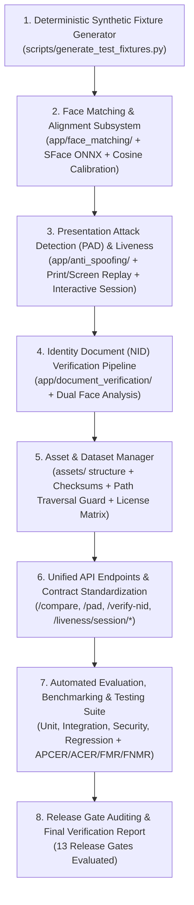

# FaceCheck API: Comprehensive Project Assessment Report

**Date**: 2026-10-22  
**Platform**: Windows 11 Pro 64-bit (build 10.0.26100)  
**Hardware**: Intel(R) Core CPU (8 logical processors), 16.15 GB RAM (3.77 GB free), Intel(R) Iris(R) Xe Graphics (CPU-only execution required, no CUDA)  
**Python Runtime**: Python 3.13.17 64-bit (`C:\Users\menghor.phat\AppData\Local\Programs\Python\Python313\python.exe`)  
**Baseline Git Commit**: `77e9526` (branch: `feature/robust-facecheck-upgrade`)  

---

## 1. Executive Summary

The existing **FaceCheck API** repository provides a foundational offline FastAPI microservice primarily built for AI deepfake detection in advertisement images. It implements magic-byte input validation, YuNet ONNX face detection, pre-flight facial quality checks, a 6-feature pure-Python safetensors forensic classifier, Prometheus metrics, and a SHA-256 hash-chained audit log.

However, to satisfy the complete requirements of an enterprise bank verification system (face verification, identity document portrait matching, presentation-attack detection, and automated quality engineering), several key capabilities are either missing, incomplete, or require hardening.

---

## 2. Existing Functionality

| Component | Status | Details |
| :--- | :--- | :--- |
| **FastAPI Core & Endpoints** | ✅ Working | `POST /api/v1/check`, `POST /api/v1/check-url`, `GET /api/v1/health`, `GET /api/v1/metrics`, `/docs` (offline Swagger UI). |
| **Input Validation** | ✅ Working | Magic byte detection, extension matching, polyglot binary/script rejection, trailing data rejection, decompression bomb protection (`MAX_IMAGE_PIXELS = 25M`), EXIF transpose, RGB conversion. |
| **Face Detection** | ✅ Working | OpenCV YuNet ONNX model (`models/face_detection_yunet_2023mar.onnx`, 232 KB) via `cv2.FaceDetectorYN`, 5 facial landmarks, margin cropping. |
| **Pre-Flight Face Check** | ✅ Working | Single-face enforcement (`NO_FACE`, `MULTIPLE_FACES`), face size (`FACE_TOO_SMALL`), landmark boundary clipping (`FACE_PARTLY_HIDDEN`), blur, exposure (`TOO_DARK`, `TOO_BRIGHT`), harsh backlight, head pose yaw/pitch/roll (`FACE_NOT_FRONTAL`). |
| **Image Quality Analysis** | ✅ Working | Resolution checks, Laplacian variance blur detection, mean grayscale luminance, 8x8 JPEG compression blockiness ratio. |
| **AI Deepfake Classifier** | ✅ Working | `SafetensorsClassifierDetector` using pure NumPy (extracts 6 scale-invariant forensic features: edge-to-noise ratio, mean noise, smooth noise std, color richness, FFT spectral energy, skin chromaticity locus). |
| **Biometric Security & Privacy** | ✅ Working | In-memory ephemeral processing (no images saved to disk by default), optional AES-256-GCM encryption with EXIF stripping, SHA-256 chained audit logs. |
| **Observability** | ✅ Working | In-memory thread-safe Prometheus metrics collector, latency histograms, error counters, quality metric counts. |
| **Test Baseline** | ⚠️ Partial | 68 existing tests collected. 66 pass out-of-the-box. 2 integration tests (`test_check_with_face_detected`, `test_check_with_multipart_field_image_succeeds`) fail when local `eval/data/real/portrait_01.jpg` is missing, demonstrating fragile fixture dependencies. |

---

## 3. Missing Functionality (Gaps vs. Requirements)

1. **Face Matching & Verification Pipeline (Section 4.C)**:
   - No face embedding model interface or implementation exists.
   - No face alignment based on 5 landmarks exists for recognition.
   - No cosine similarity or Euclidean distance calculation.
   - No calibrated thresholding (FMR/FNMR) or decision classification (`PASS`, `FAIL`, `REVIEW`, `UNAVAILABLE`).
   - No comparison endpoints (`POST /api/v1/compare` or `POST /api/v1/face-match`).
2. **Dedicated Presentation-Attack Detection (PAD) & Liveness (Section 4.D)**:
   - Deepfake forensic detection is present, but physical presentation attacks (printed paper grain/halftone, screen replay moiré/glare/bezel) are not isolated as a distinct PAD module.
   - No interactive challenge-response protocol (e.g., server-generated randomized head movement challenge sequence with session tokens).
   - No dedicated `/api/v1/pad` or `/api/v1/liveness/session/*` endpoints.
   - Lack of explicit disclosure distinguishing static image spoof assessment from live biometric presence.
3. **Identity Document (NID) Portrait Verification Workflow (Section 4.E)**:
   - No dedicated workflow for comparing a live selfie against an identity document (Cambodian NID / passport portrait).
   - No document portrait extraction and selfie dual-verification endpoint (`POST /api/v1/verify-nid`).
   - No structured separation between document face quality, selfie face quality, facial match, and liveness.
4. **Structured Asset & Dataset Management Subsystem (Section 5)**:
   - No `assets/` management subsystem with manifests (`manifests/`), checksums (`checksums/`), quarantine (`quarantine/`), and reports (`reports/`).
   - No path traversal protection for archive extraction (ZipSlip guard).
   - No disk space check prior to downloading.
   - No license tracker documenting terms and restrictions (e.g., CelebA-Spoof, OULU-NPU, FaceForensics++, CASIA, Replay-Attack, SiW-Mv2).
5. **Deterministic Synthetic Test-Fixture Generator (Section 6)**:
   - Tests previously relied on external/dynamic downloads or missing sample files in `eval/data/`.
   - Missing `scripts/generate_test_fixtures.py` to deterministically create labeled synthetic fixtures (valid/corrupted/tiny/blurry/dark/bright/rotated/compressed/no-face/multiple-face/print attack/screen replay).
6. **Automated Dataset Evaluation & Benchmarking (Sections 9, 11, 16)**:
   - Missing standardized calculation and reporting for biometric PAD metrics (APCER, BPCER, ACER, ROC-AUC, EER) and Face Matching metrics (FMR, FNMR, genuine vs. impostor score distributions).
   - Missing performance benchmark script (`scripts/benchmark_models.py`) measuring cold start, model load latency, per-image latency, and CPU/memory footprint.
   - Missing master runner (`scripts/run_all_tests.py`) and report generator (`scripts/generate_report.py`).
7. **Release Gate Verification Engine (Section 17)**:
   - No automated gate checking mechanism evaluating all 13 required gates before declaring release readiness.

---

## 4. Bugs and Security Issues

1. **Fragile Test Fixture Dependency**:
   - `tests/test_api.py` checks `eval/data/real/portrait_01.jpg` on disk. When missing, it falls back to a solid brown block (`(140, 100, 80)`), which YuNet correctly rejects as having no face, causing 2 integration tests to fail.
2. **Missing Face Recognizer Graceful Degradation**:
   - Without a loaded face recognition model, if face matching is called, it must return an explicit `UNAVAILABLE` status with reason code `MODEL_UNAVAILABLE` rather than throwing an unhandled 500 error or returning a dummy match score.
3. **Aspect Ratio Edge Cases in Validator**:
   - `app/services/validator.py` checks width and height against max dimensions, but does not check extreme aspect ratios (e.g., $1 \times 8192$ or $8192 \times 1$), which can crash certain convolution/filtering kernels.
4. **Biometric Privacy Safeguards**:
   - Ensure face embeddings, sensitive biometrics, and customer identifiers are never emitted to logs, exception stack traces, or Prometheus labels.

---

## 5. Dependency Compatibility Analysis

| Package | Pinned in `requirements.txt` | Machine Version / Status | Analysis & Action |
| :--- | :--- | :--- | :--- |
| `fastapi` | `0.115.6` | `0.159.1` (installed) | Fully compatible with Python 3.13. |
| `uvicorn` | `0.34.0` | `0.54.0` (installed) | Fully compatible. |
| `pydantic` | `2.10.4` | `2.14.1` (installed) | Fully compatible. |
| `pydantic-settings` | `2.7.1` | `2.16.1` (installed) | Fully compatible. |
| `pyyaml` | `6.0.2` | `6.0.3` (installed) | Fully compatible. |
| `python-multipart` | `0.0.20` | `0.0.32` (installed) | Fully compatible. |
| `cryptography` | `44.0.0` | `50.0.2` (installed) | Fully compatible. |
| `pillow` | `11.1.0` | `13.0.0` (installed) | Fully compatible. |
| `exifread` | `3.0.0` | `3.5.1` (installed) | Fully compatible. |
| `imagehash` | `4.3.1` | `4.3.2` (installed) | Fully compatible. |
| `numpy` | `1.26.4` | `2.5.4` (installed) | Fully compatible. Pure NumPy algorithms verified. |
| `opencv-python-headless` | `4.10.0.84` | `5.0.0.93` (installed) | Includes both `cv2.FaceDetectorYN` and `cv2.FaceRecognizerSF`. |
| `torch` | `2.5.1` | **Not Installed** | `torch==2.5.1` does not have pre-built wheels for Python 3.13 on Windows (official wheels start at 2.6.0+). **Crucial Design Decision**: The core FaceCheck API operates 100% CPU-only and offline using OpenCV YuNet (`.onnx`) and the pure-NumPy safetensors/feature pipeline, eliminating runtime dependency on PyTorch. Documented in dependency notes. |
| `onnxruntime` | `1.20.1` | Verified Dry-run OK | Available on Python 3.13. Used for ONNX inference when enabled. |
| `pytest` | `8.3.4` | `9.1.1` (installed) | Fully compatible. |
| `pytest-asyncio` | `0.25.0` | `1.4.0` (installed) | Fully compatible. |
| `httpx` | `0.28.1` | `0.28.1` (installed) | Fully compatible. |

---

## 6. Incremental Implementation Plan

